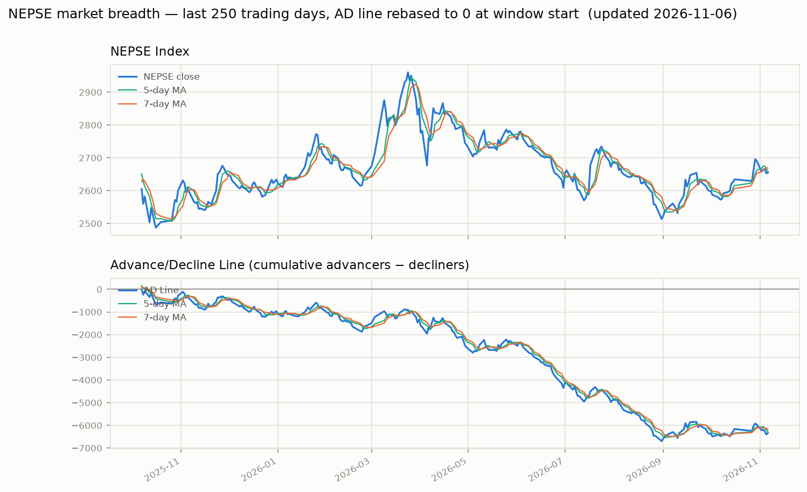

# nepse-data

nepse-data is the collection of all the datasets (from past to present) of various companies listed in the Nepal Stock Market. This repository is built for the students and people who want to perform analysis on Nepal Stock Market using historical (& current) data.

## Data

The data can be found in the [data/company-wise](https://github.com/Aabishkar2/nepse-data/tree/main/data/company-wise) folder, one CSV per company, named by its trading symbol. For example: in `NMB.csv` you can find all the data of NMB Bank Limited sorted in ascending order (date-wise).

The repository currently includes data for around 370 companies, with history going back as far as 1995. Feel free to create an issue if you want data of any particular company urgently.

Each CSV has the following columns:

| Column | Description |
| --- | --- |
| `published_date` | Trading date (`YYYY-MM-DD`) |
| `open` | Opening price |
| `high` | Day's high |
| `low` | Day's low |
| `close` | Closing price |
| `per_change` | Percentage change from the previous close (`nan` for the first row of a series) |
| `traded_quantity` | Number of shares traded |
| `traded_amount` | Total turnover for the day |
| `status` | Derived: `1` if close > open, `-1` if open > close, `0` if equal |

The Github Actions updates the data on an almost daily basis so that the datasets available here are up to date.

## Code

The code through which the data were/are being collected resides in the [src/](https://github.com/Aabishkar2/nepse-data/tree/main/src) folder. The code runs on Python 3.11 (what the GitHub Actions workflows use) and the required libraries are listed in `src/requirements.txt`.

If you want to collect the datasets by yourself then you can run the following commands.

Firstly, Just make sure you have `python3` installed 😉. If not please find python3 installation procedure over [here](https://www.python.org/downloads/)

```bash
# go into the src folder -- the scrapers must be run from here
cd src

# install requirements
pip3 install -r requirements.txt

# refresh the symbol -> company-id map from the live site
# (run this before a backfill so newly listed companies are picked up)
python3 discoverCompanies.py

# for historical data collection
# this only seeds companies that don't have a CSV yet -- existing files are left alone
python3 allDataScrapper.py

# optional -- for daily data updates
python3 dailyDataScrapper.py
```

A few things worth knowing:

- All three scripts import using paths relative to `src/`, so they only work when run from inside that directory.
- `discoverCompanies.py` regenerates `src/constants/companyIdMap.py`. That file is generated — don't hand-edit it. It merges with the existing map, so delisted companies are never dropped.
- `allDataScrapper.py` skips any symbol that already has a CSV, so re-running it won't clobber or duplicate existing data.
- `dailyDataScrapper.py` only appends to CSVs that already exist and is idempotent — running it twice in a day won't add a duplicate row.

The code that updates data on a daily basis resides in the `.github/workflows` directory and runs on Github Actions as a CRON job. The workflow runs 5 times every day (Sunday to Friday), starting at 15:15 Nepal time right after the market closes, so that if the data collection is missed the first time then it will work the second time and so on. A later run also refreshes today's row if the prices on the site changed.

## Interactive chart (GitHub Pages)

**Live: https://sauravbhattarai19.github.io/trial_nepse/**

The site has six views (tabs at the top; each has its own URL, e.g. `#v=stock&q=NABIL`):

| View | What it shows |
|---|---|
| **Today** | the market in one strip (NEPSE, breadth score, advancers/decliners, money flow, leading sectors); a "since your last visit" note; your watchlist with alerts; the **AI top-rated** stocks as cards with the reasons behind each score; **technical leaders** (the strongest charts by the textbook, with whether the AI agrees); **review before buying more** (the AI's lowest-rated liquid stocks); the setups that fired today, each with how it has actually done on NEPSE; and a market map (size = turnover, colour = 1D/1W/1M/3M return) |
| **Screener** | every stock in one sortable table (returns, AI score, trend rating, IBD-style RS, Minervini template, Weinstein stage, RSI, relative volume, recent setups, 90-day sparkline) with one-tap filters |
| **Stock** | candlesticks with 20/50/200-day averages, Supertrend, Bollinger bands, auto support/resistance, setup markers and the trailing stop; a lower pane for turnover, RSI, MACD, the stock's AI-score history or its strength vs NEPSE; side cards explaining the AI score, recent setups, the trend-template checklist and price levels |
| **Sectors** | a relative rotation graph (sectors moving Improving → Leading → Weakening → Lagging against the average stock) and a sector table; tap a sector to screen its stocks |
| **Market breadth** | the original breadth chart described below |
| **How it decides** | the evidence: how the AI and 15 well-known methods have ranked NEPSE stocks out of sample, a trading check after costs, every setup's measured record, and the live record of past suggestions |

The watchlist (☆) and "since your last visit" live in your browser only (`localStorage`).

### Stock analysis and the AI score

`scripts/build_screener.py` runs after each trading day (≈30 s). For every
stock with 120+ sessions of history it computes the readings in
`scripts/stock_features.py` — moving averages, the Minervini trend template,
Weinstein stages, Supertrend, ADX, RSI, MACD, IBD-style relative strength,
12-1 momentum, 52-week-high distance, Bollinger/Keltner squeeze,
accumulation (up/down turnover, Chaikin money flow, OBV), pocket pivots,
volatility contraction, sector strength — and detects 19 textbook setups.

The **AI score** (1–99) is a gradient-boosted tree model (scikit-learn,
textbook settings) that ranks stocks by their expected return over the next
20 sessions versus the average stock, from 35 of those readings, each turned
into a within-day rank. It is retrained every day on all data since mid-2018.
Its accuracy is measured **walk-forward**: each year since 2020 is scored by a
model trained only on earlier years (with a 22-session gap), so the record on
the site is out-of-sample. Every setup's verdict ("beat the market after" /
"lagged" / "no consistent edge") is measured on NEPSE in two separate periods
and counts only when both agree; returns are from the next day's open.

What that found (2020 – Nov 2026, out of sample):

- The AI's rank correlation with the next 20 sessions was **0.078**, positive
  in 5 of 7 years. Its best-rated tenth beat the average stock by about
  **+1.0%** per 20 sessions; its worst-rated tenth lagged by about **−0.9%**.
- Textbook trend and momentum ranks (RS rating, 12-1 momentum, trend template,
  Supertrend, MACD, RSI …) were **near zero** on NEPSE. What carried
  information: low volatility, smaller/less-traded shares, short-term
  reversal, accumulation and sector strength.
- Most textbook setups had **no consistent edge**. "Golden cross", "entered
  stage 2" and "overbought (RSI > 80)" were followed by above-average returns
  in both periods; "MACD bullish cross" and "Supertrend turned up" were
  followed by *below*-average returns.
- Trading the AI's top 10 every 20 sessions made 23.8% a year before costs but
  **12.0% after 1% round-trip costs**, below the average stock's 18.9%; its
  bottom 10 made −2.4%. The score is most useful as a filter (what to avoid,
  what to look at), not as a trading system.

Each day's suggestions are appended to `data/picks-log.csv` (upserts the
latest day only, like `signal-log.csv`), and the site scores them once 20
sessions have passed: a live record nobody can tune after the fact.

It only sees prices and turnover — not earnings, dividends, interest rates or
NRB policy. Past behaviour, not investment advice.

### Market breadth chart

A trading-style chart of the NEPSE index (candlesticks, volume, moving averages),
the Advance/Decline line and daily advancers vs decliners, with the three
panes scrolled, zoomed and crosshaired together (mouse wheel / pinch to zoom,
drag to pan). You can:

- turn **mutual funds** and **debentures** on or off: the breadth numbers,
  the AD line, the stat tiles and the CSV download are all recomputed
- pick the moving averages drawn on the price and AD-line panes: tap the
  3 / 5 / 7 / 10 / 20 / 50-day presets or type any number of days (2–1000)
  and press *Add*; up to 3 at once, calculated in the browser over trading
  days, and included in the CSV download
- switch the price pane from the NEPSE index to any company symbol
- jump to 1M / 3M / 6M / 1Y / 3Y / 5Y / All, and share a view by URL
  (e.g. `#mf=0&s=NABIL&r=3M&ma=3,5,7&p=flow&sig=ma:10:20&per=oos`)

- switch the lower pane between advancers/decliners, the **McClellan
  oscillator** and **money flow** (10-day share of turnover in rising stocks)
- use the **Sectors** table: each sector's advancers/decliners today, the
  average stock's return over 1D/1W/1M/3M/1Y (equal-weight, adjusted) and
  % above its 50-day average; tick sectors, or press *only*, to make the whole
  page (AD line, lower pane, score, signals) count just those shares
- switch the lower pane to **% above 50-day MA**, **52-week highs/lows** or
  **average stock vs NEPSE** (equal-weight ÷ index: falling means a few big
  shares are carrying the index)
- read the **Breadth signals** section: a live 0–5 breadth score, what NEPSE
  did after each score historically, and a **crossover check** that marks
  AD-line crossovers (AD × MA *n*, or MA *a* × MA *b*) on the chart and shows
  NEPSE's average move and hit rate over the next 5 and 20 days, for
  2013–2019 vs since 2020. The same check works on the **price chart**: pick
  "NABIL × MA20" or "NABIL MA10 × MA20" and it marks those crosses on the
  candles and shows what NABIL itself did next
- **backtest a rule**: tick any mix of conditions (money flow above X%, score
  at least N, AD line above its MA, AD MA crossover, McClellan above 0,
  summation rising, NEPSE above its MA), set the trading cost, and compare
  the result with buy-and-hold since 2013, for 2013–2019 and since 2020:
  return a year, worst drawdown, time in the market, trades a year, an
  equity curve and a drawdown chart, plus whether the rule is in or out today

### What the data says (study of 2013 – Nov 2026)

`python scripts/signal_study.py` reproduces all of this. Each result is checked
on 2013–2019 and on 2020–2026 separately, with returns measured from the
*next* day's open (NEPSE's opening gap already absorbs most of the previous
day's follow-through, so close-to-close tests overstate any edge).

- **The market decider:** day to day, NEPSE goes where most stocks go. Net %
  advancing explains ~77% of daily index moves. Looking ahead, the best single
  guide is *money flow*, the 10-day share of turnover in rising stocks. It beat
  the index's own momentum at predicting the next week (rank correlation 0.18 /
  0.12 vs 0.16 / 0.03).
- **Crossovers that held up in both periods:** AD line × its 10-day MA
  (bullish crosses beat bearish ones by 0.6% / 0.7% over the next week) and
  the AD line's 10-day × 20-day MA (1.9% / 3.2% over the next 20 days). Rules on
  the 50-day MA stopped working after 2020. 10 and 20 are now the default lines.
- **Bearish signals are the louder warning since 2020:** after the AD line falls
  below its 7-day MA, NEPSE was higher a week later only 33% of the time (vs 48%
  normally).
- **Breadth is a risk filter, not a return booster:** after costs no rule clearly
  beat buy-and-hold by much, but holding only while money flow is above 50%
  matched it (15.1% / 13.0% a year vs 12.2% / 13.7%) while invested about half
  the time, with roughly half the worst drawdown (−19% / −26% vs −42% / −43%).
- **Textbook divergences fail here:** NEPSE highs without AD-line confirmation
  were followed by *above*-average returns. Breadth thrusts and washouts weren't
  reliable turning points either. NEPSE behaves like a momentum market.
- **Slower participation readings faded after 2020:** % of stocks above their
  50-day average and 52-week highs minus lows predicted the next week before
  2020 (0.13) but not since (0.03); average stock vs NEPSE never did. They are
  shown as context, not used in the score.
- **Mutual funds don't change the signals** (< 0.01 difference); excluding them
  is cleaner, not more predictive.
- **Limits:** the best reading explains only ~1–4% of next-week variation. The big
  cycles are liquidity-driven (interest rates, NRB margin rules), which isn't in
  this data; a liquidity series is the natural next thing to add.

Mutual funds trade near their NPR 10 face value and debentures near NPR
1,000, so `scripts/securities.py` classifies them automatically (newly listed
funds are picked up without editing a list); the result is written to
`data/security-types.csv`.

**Price-change data repair.** Before 2018-02-19 the CSVs' `per_change` is
often a placeholder 0 although the price moved (up to ~27% of rows in
2016–17), which made breadth count those days as "unchanged". Every breadth
calculation therefore goes through `scripts/price_changes.py`: close-to-close
change for that era (moves beyond the then ±10% limit are bonus/rights
adjustments and are skipped), ShareSansar's own `per_change` afterwards (it is
already measured against the adjusted previous close), and listing days
skipped. Company charts on the site are back-adjusted for bonus/rights issues
by default (untick *Adjusted* to see raw prices).

The site is rebuilt and deployed by `.github/workflows/update-breadth-chart.yml`
every time the daily price scraper finishes. The scraper's first run is at
15:15 Nepal time, right after NEPSE's 15:00 close, so the chart is current
shortly after each trading day ends. The page source lives in `site/`;
`python scripts/build_site.py && python scripts/build_screener.py` builds it
into `_site/` (open it with `python -m http.server -d _site`).

**Keeping it running.** `data-freshness-check` runs at 17:45 and 20:45
Nepal time. If ShareSansar shows a newer trading day than the data here, it
re-runs the scraper and opens a GitHub issue (label `data-alarm`, which emails
you), then closes that issue once the data catches up. The page header shows
"Data through …" and turns amber when no new trading day has arrived for
more than four days. Each evening `scripts/log_signals.py` also records that
day's breadth score and crossovers in `data/signal-log.csv`, building a
forward-tested track record that hindsight can't touch.

**One-time setup:** in the repository's *Settings → Pages*, set **Source** to
**GitHub Actions**. After that, deployments are automatic.

## Market breadth (advancers/decliners, AD Line, NEPSE index)

This fork adds a market-breadth pipeline on top of the company-wise data above.
It runs via `.github/workflows/update-breadth-chart.yml` each time the main
data-collection workflow finishes, and produces:

- `data/market-breadth.csv` — one row per trading day: `advancers`, `decliners`,
  `unchanged`, `total_traded`, counted from every company-wise CSV.
- `data/nepse-index.csv` — the NEPSE index's own daily `open/high/low/close`,
  pulled separately from ShareSansar's index history (index_id 12), back to
  1997-07-20. This is the overall market index, not any single company's price.
- `data/combined.csv` — the two merged, plus `net_advances` (advancers −
  decliners), `ad_line` (cumulative net_advances since 1995 — the classic
  Advance/Decline Line), and 5-day/7-day moving averages of both the AD line
  and the NEPSE close.
- `charts/ad_line_recent.png` — last 250 trading days (AD line rebased to 0 at
  the window start, so short-term moves are visible against a ~30-year-old
  cumulative total).
- `charts/ad_line_full.png` — the full history.



Scripts live in `scripts/` and run in order: `fetch_nepse_index.py` →
`build_breadth.py` → `build_combined.py` → `plot_chart.py`.

## Contributing

Pull requests are welcome. Please open an issue first to discuss what you would like to change.

Things you can consider doing:

- Github action to update data on a daily basis on Kaggle
- Date-wise Collection of data from past to present

## License

[MIT](https://choosealicense.com/licenses/mit/)
